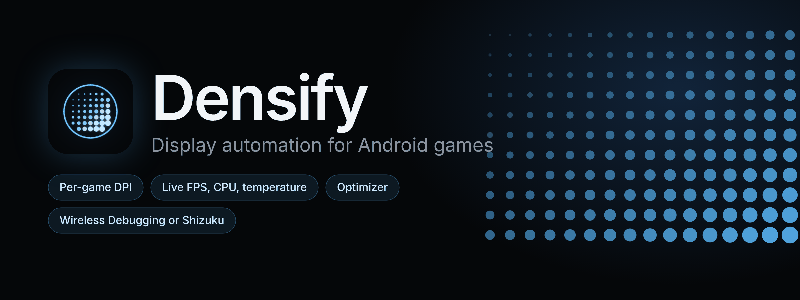
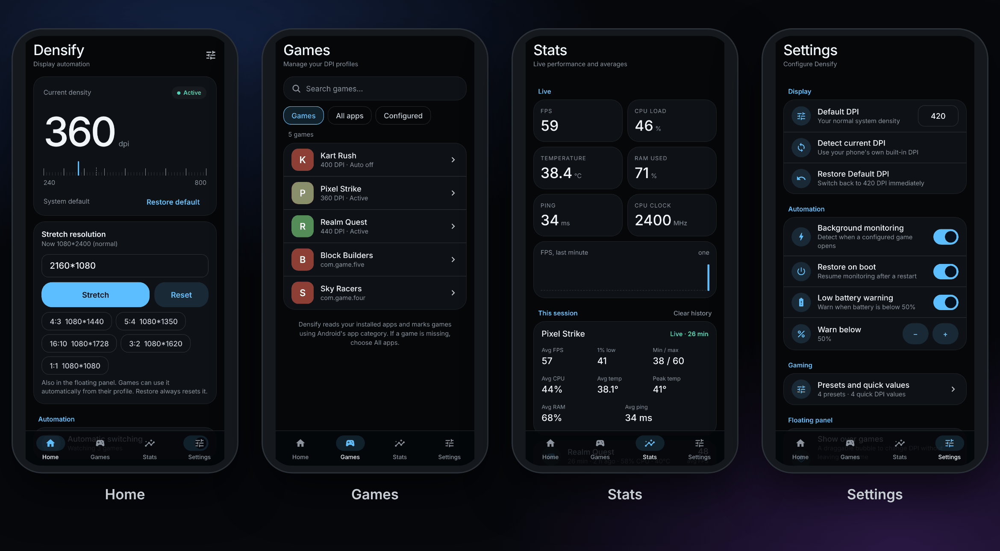
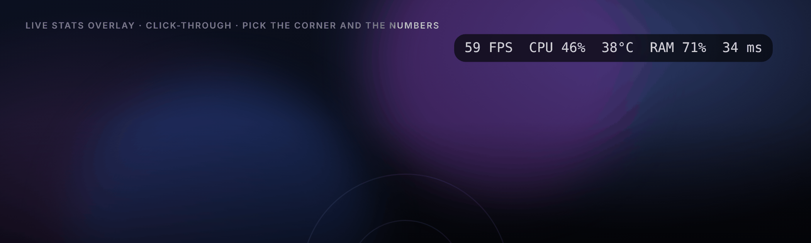
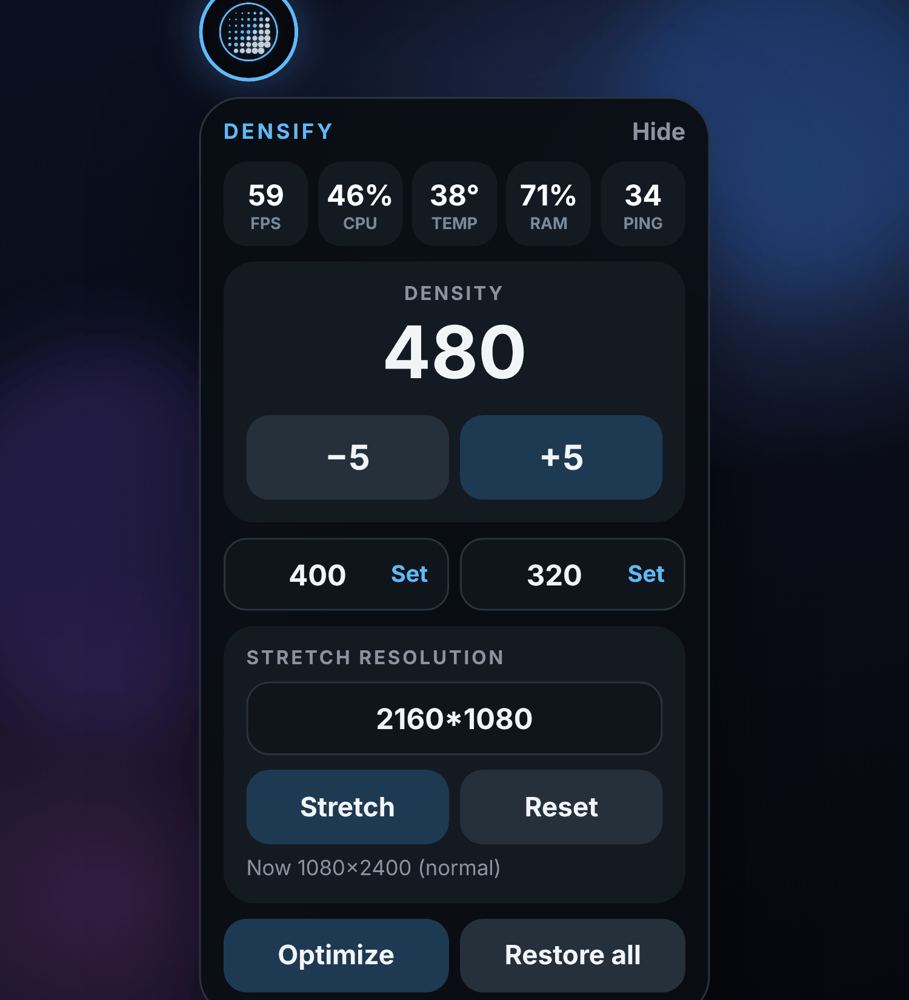
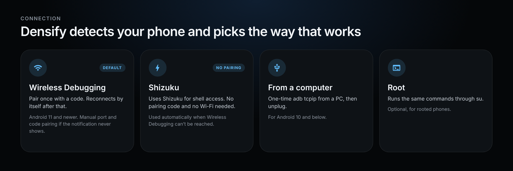
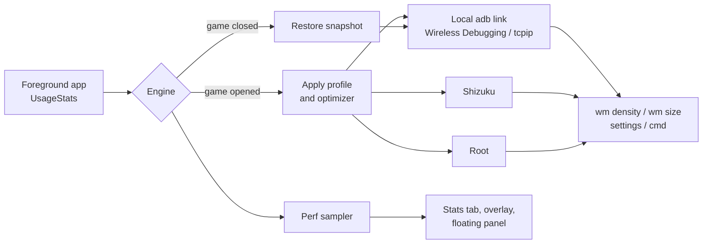

<div align="center">



**Per-game display density, live performance stats and a one-tap optimizer for Android.**
Open a game and Densify switches your DPI. Close it and everything goes back.


</div>

<br>



<sub>Screens are the app's own UI rendered with sample data.</sub>

## What it does

Densify watches which app is in front. When a game from your list opens, it applies that game's profile (DPI, screen size, refresh rate and more). When you leave, it puts your phone back exactly how it was, even if the app was killed in between.

It talks to Android through a local `adb` link that lives on the phone itself, so no computer is needed.

## Features

### Per-game profiles
- Own DPI for every game, applied on launch and restored on exit
- Presets (Esport, Balanced, Battery saver, Cinematic) that bundle refresh rate, Do Not Disturb, rotation, brightness and keep-awake
- Stretch resolution: type `2160*1080` or pick a ratio, per game or globally
- Your original values are saved as a snapshot, so a crash never leaves the screen stuck at the wrong density

### Live stats


- **FPS, CPU load, temperature, RAM and ping** shown live
- A click-through overlay in the corner you choose, with the numbers you choose: always, or only in games
- A dedicated **Stats** tab with live tiles, a one-minute FPS graph and **per-session averages** (average FPS, 1% low, min/max, CPU, average and peak temperature, RAM, ping)
- Sampling only runs while something is showing it, so the monitor costs nothing the rest of the time

### Floating panel
<p align="center"></p>

- Draggable bubble that opens over any game
- Five live stat tiles, big **−5 / +5** density buttons, two typable quick values
- Stretch resolution, **Optimize** and **Restore all** in one place
- Manual DPI changes hold for a few seconds so the engine never snaps them back

### Optimizer
Per-game and fully reversible. Each switch is undone when the game closes.
- Clear background RAM before launch
- Faster animation scale
- Low-latency Wi-Fi mode and no background scans
- Game Mode performance hint

### Terminal
- A built-in shell for `wm size`, `wm density` and anything else you would run over adb
- Exit codes are shown, the shell recovers if it dies, and the current screen state is read back after every `wm` command
- History and one-tap chips for common commands

### Connection


Densify reads your phone model, Android version and ROM (OxygenOS, ColorOS, realme UI, HyperOS, MIUI, One UI and others), recommends the method that works best on it, and falls back by itself:

| Method | Notes |
| --- | --- |
| Wireless Debugging | Android 11+. Pair once; reconnects by itself. Retries and recycles the setting when a ROM is slow to respond. Manual port and code pairing is available. |
| Shizuku | If Shizuku is running, Densify gets its shell link through it with no pairing code and no Wi-Fi. |
| adb tcpip | For Android 10 and below, set up once from a computer. |
| Root | Optional. Runs the same commands through `su`. |

## How it works



## Compatibility

- Android 7 (API 24) and newer
- Wireless Debugging needs Android 11 or newer; older versions use Shizuku, root or adb tcpip
- Shizuku and root are optional
- Some phones do not expose every number. A value the phone hides shows as a dash instead of a guess

## Privacy

Everything runs on the device. Densify has the `INTERNET` permission for one reason: the ping reading sends a single small probe to `8.8.8.8`. No accounts, no analytics, no data leaves the phone.

## Tech stack

| Layer | Tech |
| --- | --- |
| App | Expo SDK 57, React Native 0.86, React 19, TypeScript |
| Native | Local Expo module in Kotlin (`modules/densify-native`) |
| ADB | [libadb-android](https://github.com/MuntashirAkon/libadb-android) with Conscrypt for TLS |
| Shizuku | Raw binder client, no extra library |
| Overlays | `TYPE_APPLICATION_OVERLAY` windows built from plain Views |
| Builds | EAS Build |

## Project structure

```
App.tsx                      app shell and tab routing
src/
  screens/                   Home, Games, Stats, Settings, Setup, Tools, Profile ...
  logic/                     hooks, permissions, perf sampling
  native/api.ts              typed wrapper over the native module
  store/                     app state, defaults, debounced persistence
  theme/  ui/                themes and shared components
modules/densify-native/
  android/src/main/java/     Engine, Hub (adb), ShizukuLink, Perf, Floating,
                             DeviceInfo, PairingService, MonitorService ...
docs/images/                 README images
```

## Credits

- [libadb-android](https://github.com/MuntashirAkon/libadb-android) by Muntashir Al-Islam
- [Conscrypt](https://github.com/google/conscrypt)
- [Shizuku](https://github.com/RikkaApps/Shizuku) by RikkaApps, whose binder protocol Densify speaks
- AxManager, an inspiration for the plugin and WebUI ideas

## License

MIT. See [LICENSE](LICENSE).
