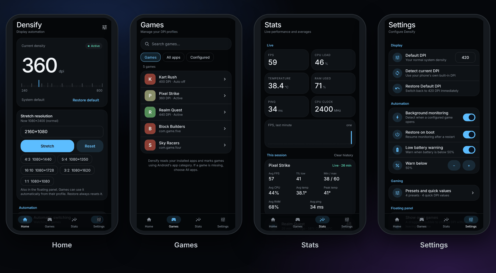
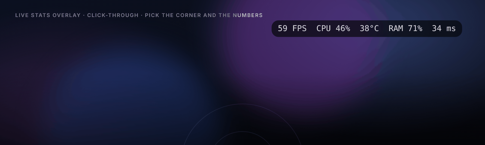
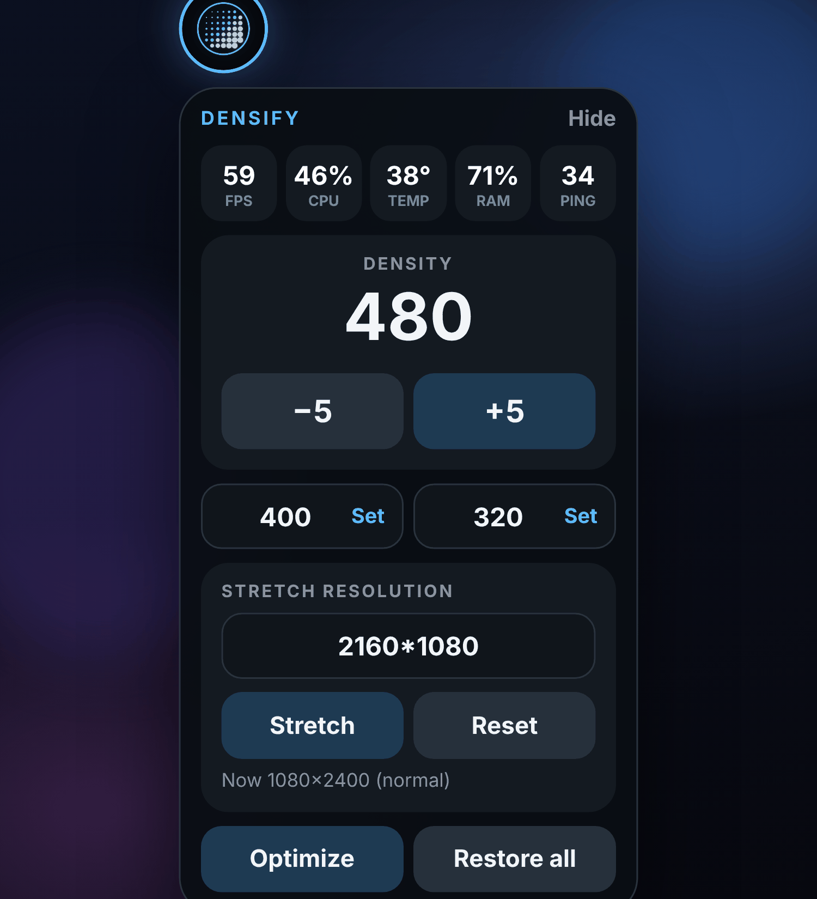
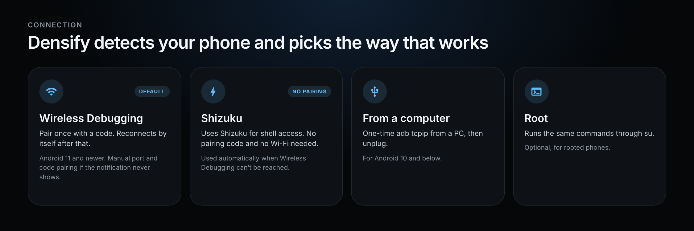
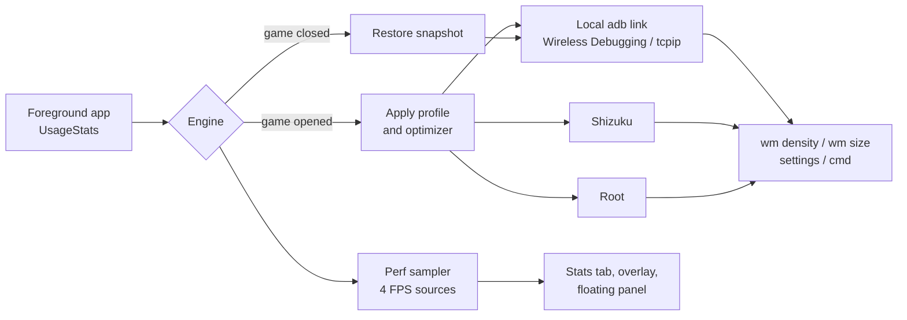

<div align="center">

# Densify

**Per-game smallest width, live FPS and performance stats, a game optimizer, plugins and a light screen recorder for Android.**
Open a game and Densify switches your smallest width. Close it and everything goes back.


</div>

<br>



## What it does

Densify watches which app is in front. When a game from your list opens, it applies that game's profile: smallest width, screen size, refresh rate, Do Not Disturb and more. When you leave, it puts the phone back exactly how it was, even if the app was killed in between.

It talks to Android through a local `adb` link that lives on the phone itself, so no computer is needed.

## The app at a glance

Five tabs along a floating bottom bar. Swipe sideways anywhere to move between them, or tap.

| Tab | What is there |
| --- | --- |
| **Home** | Your games. A compact strip at the top shows the current smallest width and the stretch resolution field. Below it, one tile per game with its icon, preset and smallest width. |
| **Stats** | Live FPS, CPU, temperature, RAM and ping, session history, the on-screen overlay and the optimizer. |
| **Record** | The screen recorder. |
| **Plugins** | Plugins and automation scripts in one place. |
| **Settings** | Connection, floating panel, themes, permissions and tools. |

## Features

### Smallest width, not DPI
Everywhere in Densify the number is the **smallest width** in dp, the same number Android shows under Developer options. If your default is 420, the phone goes back to smallest width 420. If a game is set to 490, the screen's smallest width becomes 490. Densify converts that to a density only at the moment it applies it, using your screen's real size, so the number you see is the number you get. A higher value gives a smaller UI with more room, a lower value a bigger UI.

### Home: your games
- One tile per game: the game's own icon fills the tile, with its preset and smallest width on top
- A small **AUTO / OFF** button on each tile turns automatic switching on or off for that game alone
- A single small switch pauses automatic switching for every game
- Tap a tile to open the game's profile, with a **Play** button that launches the game
- The sw counter, status and stretch resolution sit in one compact strip at the top
- Banners tell you when Wireless Debugging is not connected, with a one-tap Set up

### Per-game profiles
- Own smallest width for every game, applied on launch and restored on exit
- Presets (Esport, Balanced, Battery saver, Cinematic) that bundle refresh rate, Do Not Disturb, rotation, brightness and keep-awake
- Stretch resolution: type `2160*1080`, per game or globally
- Your original values are saved as a snapshot, so a crash never leaves the screen stuck at the wrong density

### Live stats and FPS


- **FPS, CPU load, temperature, RAM and ping**, live
- A click-through overlay in the corner you choose, with the numbers you choose: always, or only in games
- Per-session averages: average FPS, 1% low, min and max, CPU, average and peak temperature, RAM, and ping with its low and high
- Sampling only runs while something is showing it, so the monitor costs nothing the rest of the time

**FPS works across phones and ROMs.** Phones differ (stock Android, One UI, ColorOS and OxygenOS, MIUI and HyperOS, Funtouch and more), so Densify tries four sources and uses the first that reports frames:

1. SurfaceFlinger frame timing on the game's own layer (the most accurate)
2. SurfaceFlinger `--timestats`, the compositor's own per-layer frame count (Android 10+), sampled over time
3. HWUI frame stats from `gfxinfo`, for apps drawn by Android's UI renderer
4. SurfaceFlinger's whole-screen frame counter, when a phone hides layer names

A number a phone refuses to give shows as a dash instead of a guess.

### Floating panel
<p align="center"></p>

A control panel that opens over any game. It scrolls, so every control is reachable on a short landscape screen, and it follows the app's theme, including liquid glass. It has live stat tiles, **−10 / −5 / +5 / +10** smallest-width buttons, two typable quick values, stretch resolution, **Optimize** and **Restore all**, and the screen recorder with a **Screen** or **One app** choice.

Two styles, chosen in Settings:

| Style | Behaviour |
| --- | --- |
| **Basic** | A draggable logo bubble. It snaps to the nearest side of the screen, and when it is near an edge the panel slides in so it never runs off the screen. |
| **Dynamic island** | A slim, pure black pill like a phone's dynamic island. It sits right over your camera cut-out and wraps it. Tap it to open the full panel. You can write **DENSIFY** in it in light blue (off by default). Put it at the **top** (camera side) or on the **right** (the top of the phone when held sideways), or **drag it anywhere**. Its **size** and **opacity** are adjustable. |

### Themes and liquid glass
- Seven themes: Paper (default, white with light blue), Matte, Graphite, Manga (strictly black and white), Material You, HUD and Ember
- **Liquid glass** is an option on top of any theme: frosted, translucent surfaces over a soft, continuous colour wash. It is on by default, and the floating panel follows it
- Accent colour picker that refuses colours that would disappear into the theme

### Plugins and scripts
Plugins and scripts are one area. A script is a short shell snippet that runs when a game starts, when it exits, or when the phone boots, for one game or all. A plugin adds actions you run by hand, hooks, and an optional WebUI page. Install from a zip (AxManager and KernelSU-style modules with `module.prop`, `customize.sh`, `service.sh`, `action.sh` and `webroot`) or from JSON. Plugins bundled with the app are listed under **Included with Densify** for one-tap install.

### Optimizer
Per-game and fully reversible. Each switch is undone when the game closes.
- Clear background RAM before launch
- Faster animation scale
- **Network boost**: Android's low-latency Wi-Fi mode and no background radio scans. It applies when a game from your list opens, on Wi-Fi, and the activity log says whether the low-latency switch took effect. It removes local causes of lag spikes; it cannot make your internet faster
- **Test network**: 20 quick pings with your real low, average and high latency and packet loss
- Game Mode performance hint
- Battery saver and adaptive battery off while you play
- Lower render resolution through Game Mode (90 to 60 percent)
- One-tap compile of a game's files for faster loading

### Screen recorder
- Hardware encoded, so it costs almost no CPU
- Up to **4K at 60 fps**, with a resolution, frame rate and bit rate you choose; the phone lowers anything its encoder cannot do and says so
- **Compatibility** (H.264, plays everywhere) or **Storage** (H.265, about half the size)
- Record a **single app or the whole screen** (single app needs Android 14), chosen in the app or right in the floating panel
- Start, pause, resume and stop from the notification and from the floating panel
- Saved to Movies/Densify; video only, no sound

### Terminal and tools
- A built-in shell for `wm size`, `wm density` and anything else you would run over adb
- Exit codes are shown and the shell recovers if it dies
- Activity log, backup, developer tweaks and a settings editor

### Connection


Densify reads your phone model, Android version and ROM, and offers every method in a compact grid. The **Notification method** is the recommended one on any phone with Wireless Debugging.

| Method | Notes |
| --- | --- |
| Notification | Android 11+. Pair once using the Wireless Debugging notification; reconnects by itself. Manual port and code pairing is available. |
| Shizuku | If Shizuku is running, Densify gets its shell link through it with no pairing code and no Wi-Fi. |
| Root | Connects through `su`. No pairing and no Wi-Fi needed. |
| From a computer | `adb tcpip`, for Android 10 and below or when Wireless Debugging is unavailable. |
| Split-screen | Keeps Densify visible while you complete the pairing steps. |

## How it works



## Compatibility

- Android 7 (API 24) and newer
- Wireless Debugging needs Android 11 or newer; older versions use Shizuku, root or adb tcpip
- Window blur behind the open floating panel needs Android 12 or newer; older phones get the translucent look without the blur
- Shizuku and root are optional
- Some phones do not expose every number. A value the phone hides shows as a dash instead of a guess

## Privacy

Everything runs on the device. Screen recording only happens after you accept Android's own prompt. Densify has the `INTERNET` permission for one reason: the ping reading sends a few small probes to `8.8.8.8`. No accounts, no analytics, no data leaves the phone.

## Build

```bash
npm install
npx tsc --noEmit          # typecheck
npx expo start            # dev server (the native module needs a development build)
```

Release builds use EAS:

```bash
npx eas-cli build --platform android --profile preview      # installable APK
npx eas-cli build --platform android --profile production   # app bundle
```

## Tech stack

| Layer | Tech |
| --- | --- |
| App | Expo SDK 57, React Native 0.86, React 19, TypeScript |
| Native | Local Expo module in Kotlin (`modules/densify-native`) |
| ADB | [libadb-android](https://github.com/MuntashirAkon/libadb-android) with Conscrypt for TLS |
| Shizuku | Raw binder client, no extra library |
| Glass | `expo-blur` and `expo-linear-gradient` |
| Overlays | `TYPE_APPLICATION_OVERLAY` windows built from plain Views |
| Builds | EAS Build |

## Project structure

```
App.tsx                      app shell, tab routing and swipe navigation
src/
  screens/                   Games (Home), Stats, Recorder, Plugins, Settings, Setup, Profile, Tools ...
  logic/                     hooks, permissions, perf sampling, plugin runtime, bundled plugins
  native/api.ts              typed wrapper over the native module
  store/                     app state, defaults, debounced persistence
  theme/  ui/                themes, liquid glass, tab bar and shared components
modules/densify-native/
  android/src/main/java/     Engine, Hub (adb), ShizukuLink, Perf (FPS and stats), Floating,
                             DeviceInfo, PairingService, MonitorService, Recorder ...
docs/images/                 README images
```

## Credits

- [libadb-android](https://github.com/MuntashirAkon/libadb-android) by Muntashir Al-Islam
- [Conscrypt](https://github.com/google/conscrypt)
- [Shizuku](https://github.com/RikkaApps/Shizuku) by RikkaApps, whose binder protocol Densify speaks
- AxManager, an inspiration for the plugin and WebUI ideas

## License

MIT. See [LICENSE](LICENSE).
